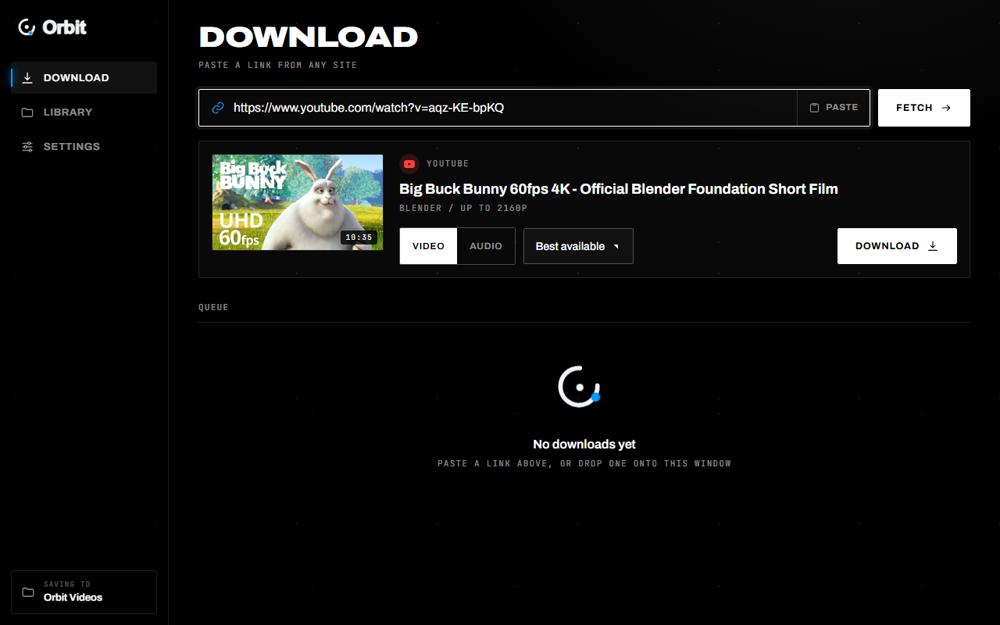
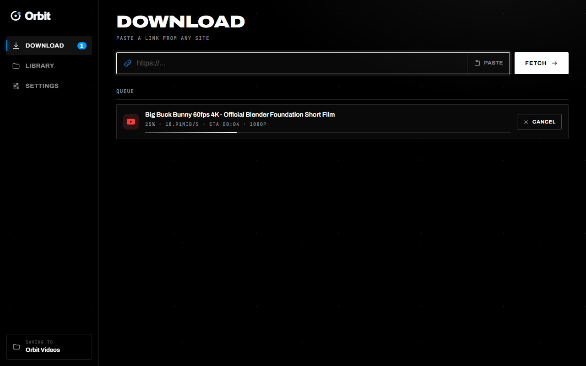
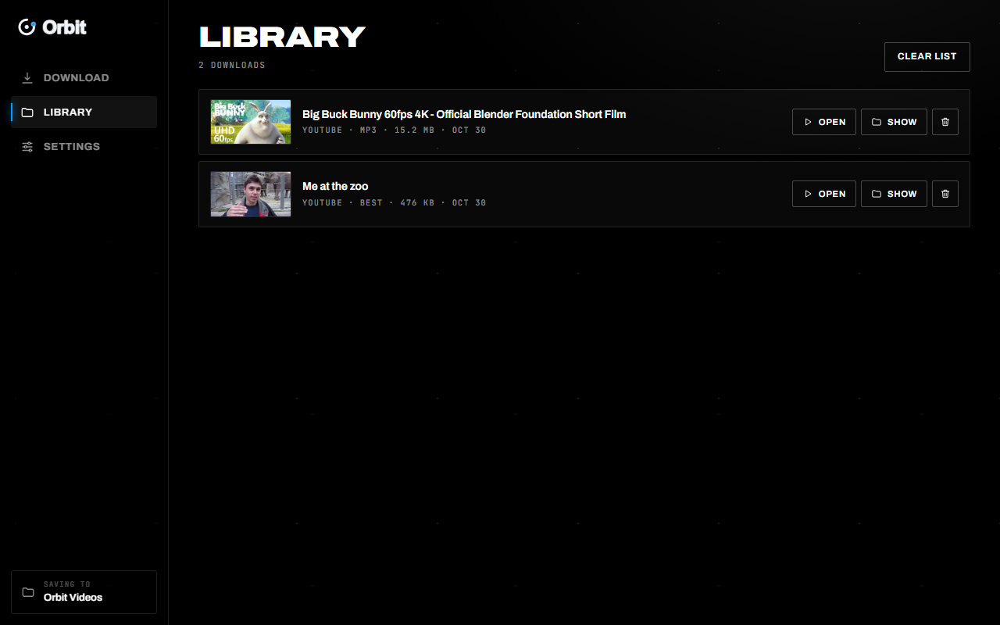
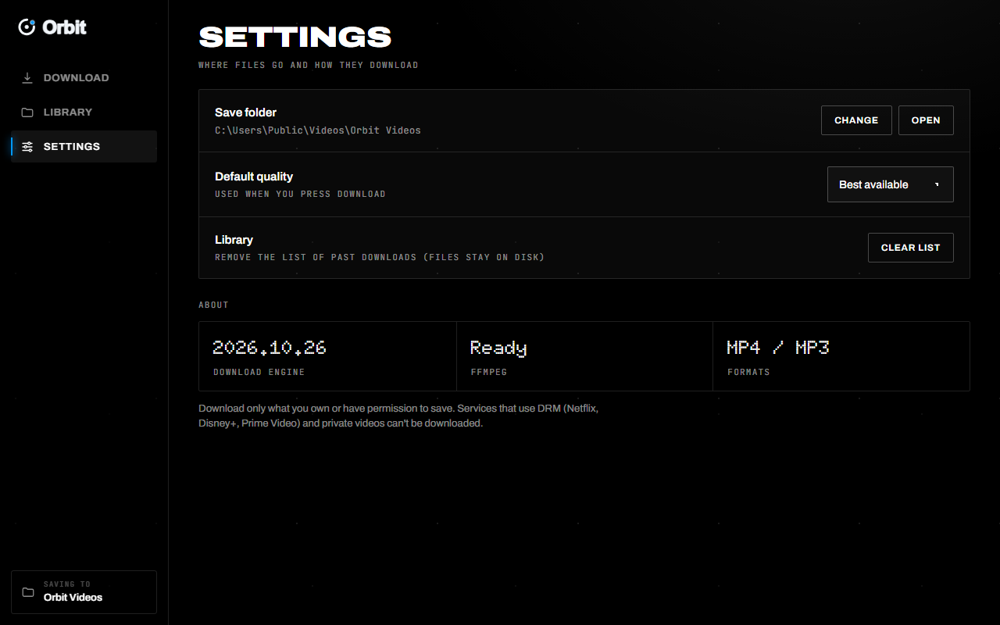

<div align="center">

  <a href="https://damsarachethiyaa-dev.github.io/orbit/">
    
  </a>

  # Orbit

  ### Desktop App — Windows 10 & 11

  **Paste any link. Download anything.**  
  *Original-quality downloads up to 4K • MP3 extraction • No accounts, no ads, no telemetry.*

  <br />

  <p>
    <a href="https://github.com/damsarachethiyaa-dev/orbit/releases/download/v1.0.9/Orbit-Setup.exe">
      
    </a>
    &nbsp;
    <a href="https://damsarachethiyaa-dev.github.io/orbit/">
      
    </a>
  </p>

  <p>
    <a href="https://github.com/damsarachethiyaa-dev/orbit/releases/latest">
      
    </a>
    &nbsp;
    <a href="https://github.com/yt-dlp/yt-dlp">
      
    </a>
    &nbsp;
    <a href="https://damsarachethiyaa-dev.github.io/orbit/">
      
    </a>
    &nbsp;
    <a href="LICENSE">
      
    </a>
  </p>

  <p>
    <a href="https://github.com/damsarachethiyaa-dev/orbit">
      
    </a>
    &nbsp;
    <a href="https://github.com/damsarachethiyaa-dev/orbit/releases/latest">
      
    </a>
  </p>

  <br />

  <a href="https://damsarachethiyaa-dev.github.io/orbit/">
    
  </a>

</div>

<br />

---

## 🌐 Official Website & Live Showcase

Experience the full interactive editorial website, live 4K walkthrough player, platform support directory, and architecture breakdown:

👉 **[https://damsarachethiyaa-dev.github.io/orbit/](https://damsarachethiyaa-dev.github.io/orbit/)**

---

## ✨ Features

- **⚡ Instant Clipboard Sensing:** Orbit automatically detects copied video links from your clipboard. Paste, press Fetch, and choose your resolution.
- **🎬 Original-quality video:** Fetches the source streams (4K and 60fps where the site offers them) without re-encoding. On Android, the optional **Share-ready** mode saves H.264 + AAC so files play in WeChat, WhatsApp and Telegram; resolutions that only exist as VP9/AV1 are converted to H.264 after download.
- **🎵 MP3 extraction:** One-tap MP3 at LAME's highest variable-bitrate setting, with metadata and album art embedded. (MP3 is lossy; the source audio is re-encoded.)
- **📦 Zero Dependencies, Pre-Bundled:** Includes embedded FFmpeg, FFprobe, and the yt-dlp core. No terminal, no Python, no codec installs needed.
- **📥 Parallel Multi-Download Queue:** Run concurrent background downloads with live throughput speeds (MB/s), elapsed time, and ETA countdowns.
- **📁 Local-First Media Library:** Automatically catalogs your finished downloads with thumbnails. One click to play or reveal directly in Windows Explorer.
- **🔒 Private by design:** No sign-ups, no accounts, no telemetry and no ads. Orbit only contacts the sites you download from and GitHub (to check for updates).

### 📱 Android ([latest APK](https://github.com/damsarachethiyaa-dev/orbit/releases/latest/download/Orbit.apk))

- **Share-ready by default:** videos are saved as H.264 + AAC MP4. Orbit reads each file with FFmpeg and records its real codec, so the Library shows what you actually have (for example `1080p · H.264 · Share-ready`).
- **Share sheet:** send straight to WeChat, WhatsApp or Telegram (shown only if installed), or convert a copy: *share-ready* (same resolution) or *smaller for chats* (up to 720p).
- **Background downloads that survive:** one foreground notification, automatic retry on connection drops, resume of direct downloads, and unfinished jobs are restored if Android kills the app.
- **Search tab:** results come from YouTube via yt-dlp. There is no AI involved.

Orbit does not promise to fit any app's file-size limit; chat apps change their limits, so check the one you use.

---

## 🖥️ Screen Previews

| Multi-Download Queue | Local Offline Library | Configurable Settings |
|:---:|:---:|:---:|
| <a href="https://damsarachethiyaa-dev.github.io/orbit/"></a> | <a href="https://damsarachethiyaa-dev.github.io/orbit/"></a> | <a href="https://damsarachethiyaa-dev.github.io/orbit/"></a> |

---

## 🚀 Quick Start (Windows)

1. Download the Windows Setup Installer (`Orbit-Setup.exe`) from the **[latest release that includes it](https://github.com/damsarachethiyaa-dev/orbit/releases)**.
2. Double-click `Orbit-Setup.exe` to install Orbit and launch it.
3. Paste any video or audio link (YouTube, TikTok, Instagram, X, Vimeo, Reddit, Twitch, etc.) and hit **Fetch**.
4. Choose **Video** (4K, 1440p, 1080p, 720p) or **Audio** (MP3) and click **Download**.

> [!NOTE]  
> Because Orbit is a standalone open-source release that is not code-signed with an enterprise certificate, Windows SmartScreen may show a prompt on first run: click **More info → Run anyway**.

---

## 🛠️ Building from Source

### Requirements
- Python 3.11+
- Windows 10 or 11 (64-bit) with Edge WebView2 Runtime

### Setup & Run
```powershell
git clone https://github.com/damsarachethiyaa-dev/orbit.git
cd orbit

# Create virtual environment & install dependencies
python -m venv .venv
.\.venv\Scripts\activate
pip install -r requirements.txt

# Run Desktop Application
python desktop.py
```

### Build Single Executable (.exe)
```cmd
build.bat
```
The output standalone binary will be generated at `dist\Orbit.exe`.

---

## 📂 Project Structure

```text
orbit/
├── docs/                 # GitHub Pages website (https://damsarachethiyaa-dev.github.io/orbit/)
│   ├── css/              # Editorial typography & dark monochrome design system
│   ├── js/               # Lenis inertial scroll, glowing thread & motion physics
│   ├── icons/            # 28+ official platform SVG brand marks
│   ├── screenshots/      # High-resolution application screenshots
│   └── index.html        # Main landing page
├── static/               # Local website & embedded desktop assets
├── app.py                # Flask backend with yt-dlp & FFmpeg pipeline
├── desktop.py            # pywebview Windows desktop wrapper
├── build.bat             # PyInstaller standalone .exe compilation script
└── requirements.txt      # Python dependencies
```

---

## 📜 Responsible Use & License

Orbit is distributed under the **[MIT License](LICENSE)**.

Orbit is designed to save media you own or have the explicit right to download for personal offline archiving. Videos protected by DRM (e.g. Netflix, Disney+, Prime Video, Spotify) or private accounts cannot be downloaded.
