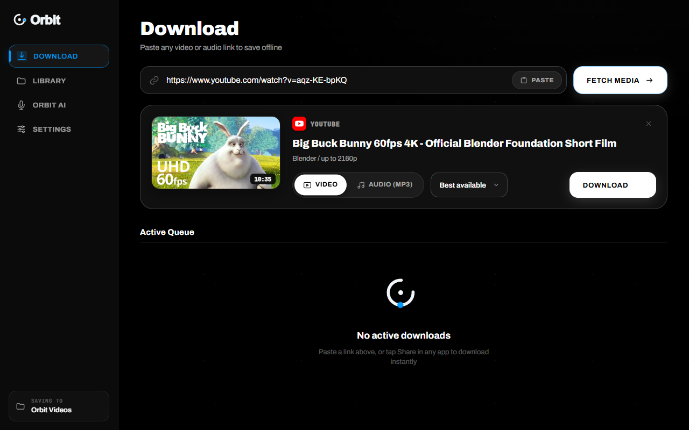
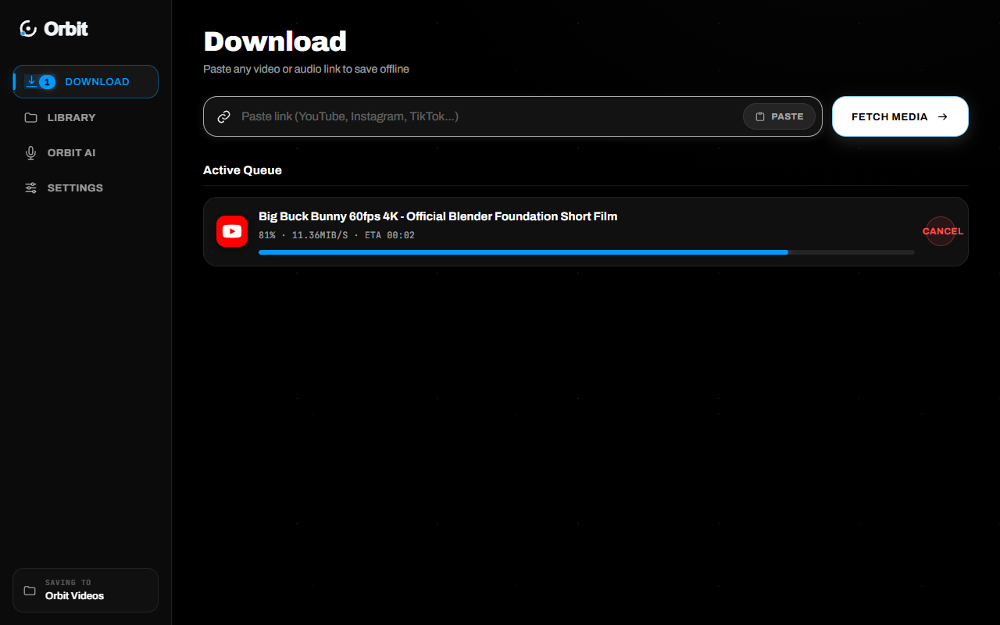
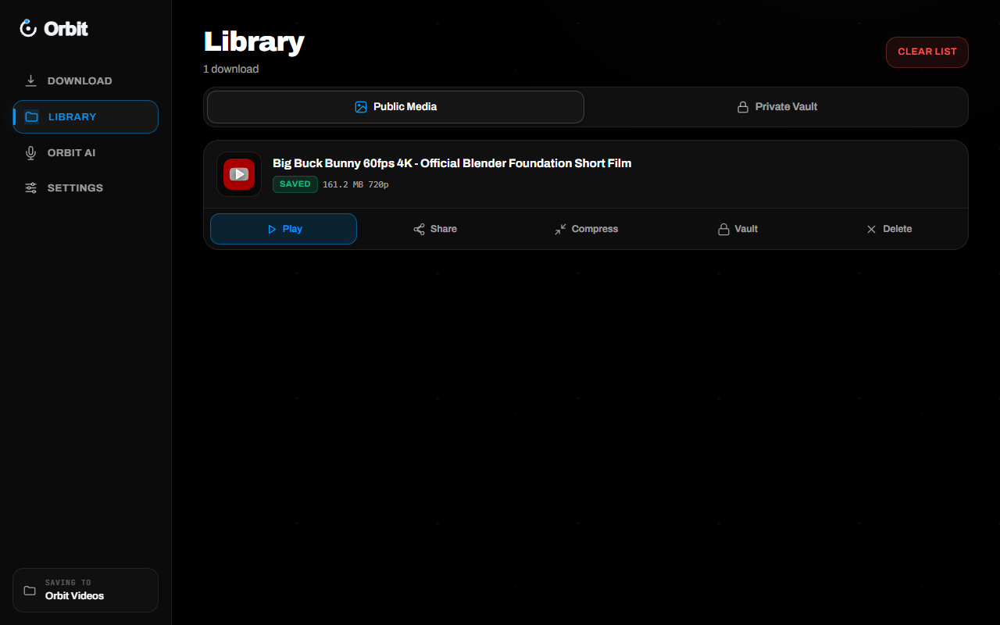
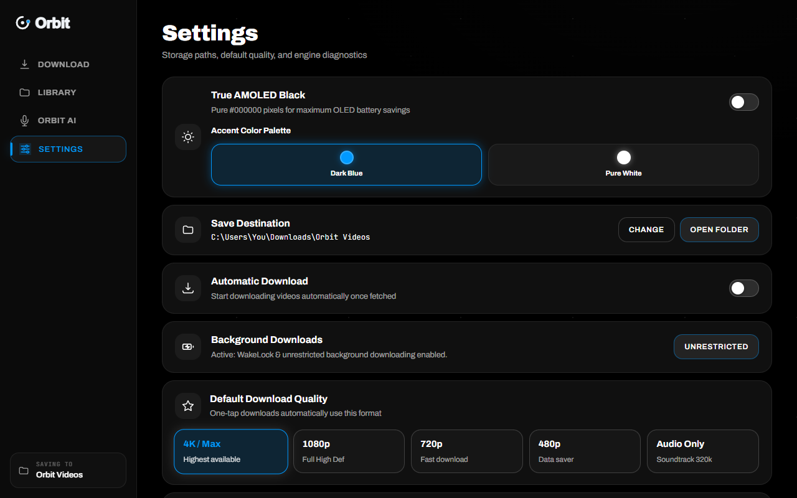

  

  # Orbit

  ### Desktop & Android App — Windows 10 / 11 • Android

  **Paste any link. Download anything.**  
  *Original-quality downloads up to 4K • MP3 extraction • No accounts, no ads, no telemetry.*

   

  

    
    &nbsp;
    
    &nbsp;
    
  

  

    
    &nbsp;
    
    &nbsp;
    
    &nbsp;
    
  

  

    
  

   

  

 

---

## 🌐 Official Website & Live Showcase

Explore the full interactive website, live walkthrough player, and the list of supported platforms:

👉 **[https://damsarachethiyaa-dev.github.io/orbit/](https://damsarachethiyaa-dev.github.io/orbit/)**

---

## ✨ Features

- **⚡ Instant Clipboard Sensing:** Orbit detects copied video links from your clipboard. Paste, press Fetch, and choose your resolution.
- **🎬 Original-quality video:** Fetches the source streams (4K and 60fps where the site offers them) without re-encoding. On Android, the optional **Share-ready** mode saves H.264 + AAC so files play in WeChat, WhatsApp and Telegram.
- **🎵 MP3 extraction:** One-tap MP3 at the highest variable-bitrate setting, with metadata and album art embedded.
- **📦 Nothing else to install:** FFmpeg and the download engine come built in. No terminal, no Python, no codec packs.
- **📥 Parallel Multi-Download Queue:** Run several downloads at once with live speed (MB/s), elapsed time, and ETA countdowns.
- **📁 Local-First Media Library:** Finished downloads appear with thumbnails. One click to play or show them in Windows Explorer.
- **🔒 Private by design:** No sign-ups, no accounts, no telemetry and no ads. Orbit only contacts the sites you download from and GitHub (to check for updates).
- **🔄 Automatic updates:** Both the Windows and Android apps tell you when a new version is out.

### 📱 Android ([latest APK](https://github.com/damsarachethiyaa-dev/orbit/releases/latest/download/Orbit.apk))

- **Share-ready by default:** videos are saved as H.264 + AAC MP4, and the Library shows what you actually have (for example `1080p · H.264 · Share-ready`).
- **Share sheet:** send straight to WeChat, WhatsApp or Telegram, or convert a copy: *share-ready* (same resolution) or *smaller for chats* (up to 720p).
- **Background downloads that survive:** one notification, automatic retry when the connection drops, and unfinished jobs come back if Android closes the app.
- **Search tab:** search YouTube right inside Orbit.

---

## 🖥️ Screen Previews

| Multi-Download Queue | Local Offline Library | Configurable Settings |
|:---:|:---:|:---:|
|  |  |  |

---

## 🚀 Quick Start

### Windows
1. Download **`Orbit-Setup.exe`** from the [latest Windows release](https://github.com/damsarachethiyaa-dev/orbit/releases/download/v1.0.28/Orbit-Setup.exe).
2. Double-click it to install Orbit, then launch it.
3. Paste any video or audio link (YouTube, TikTok, Instagram, X, Vimeo, Reddit, Twitch and more) and hit **Fetch**.
4. Choose **Video** (4K, 1440p, 1080p, 720p) or **Audio** (MP3) and click **Download**.

> [!NOTE]  
> Orbit is not code-signed with an expensive enterprise certificate, so Windows SmartScreen may show a prompt on first run: click **More info → Run anyway**.

### Android
1. Download **`Orbit.apk`** from the [latest release](https://github.com/damsarachethiyaa-dev/orbit/releases/latest/download/Orbit.apk).
2. Open it and allow installing from your browser or file manager.
3. Share a link to Orbit from any app, or paste it in, and download.

---

## 📜 Responsible Use

Orbit is made for saving media you own or have the right to download, for personal offline use. Videos protected by DRM (for example Netflix, Disney+, Prime Video, Spotify) or private accounts cannot be downloaded.

This repository holds the website and the app downloads only.

